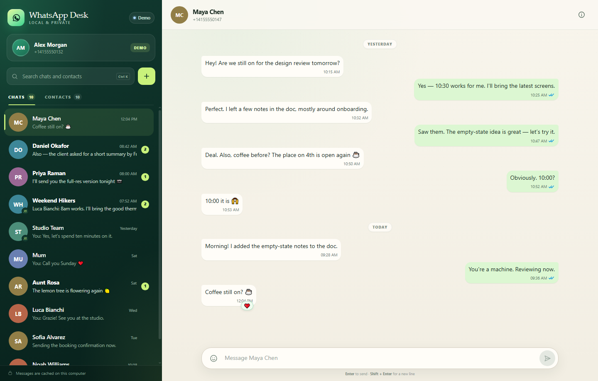

# WhatsApp Desk

A private, local dashboard for WhatsApp on your computer. Link your phone once by scanning a QR code, then read conversations, browse your contact list, and reply without picking up your phone.



## What it does

- **Link by QR code** — pair this computer as a WhatsApp linked device.
- **See your chats and contacts** — a searchable chat list and a separate, alphabetised contact list.
- **Read messages** — text, images, video, voice notes, documents, stickers, locations, contact cards, replies, and reactions.
- **Send messages** — type and send from the dashboard, with delivery and read ticks, typing indicators, and optimistic sending.
- **Optional auto-reply** — toggle it from the sidebar and set your own message and per-contact cooldown.
- **Stay in sync live** — new messages, edits, reactions, and read receipts update immediately.
- **Keep your data local** — messages are cached in `.data/` on this computer. There is no cloud service or account attached to this app.
- **Preview safely** — `start-demo.bat` opens a full sample workspace without touching a real WhatsApp account.

## Quick start

**Requirement:** [Node.js 20 or newer](https://nodejs.org). Windows 10/11 is required for the `.bat` launchers; the server itself also runs on macOS and Linux.

1. Double-click **`start.bat`**.
2. The first run installs dependencies automatically, then opens <http://127.0.0.1:3000>.
3. In WhatsApp on your phone, go to **Settings → Linked devices → Link a device**, and scan the QR code on screen.
4. The app switches to your chats as soon as the link completes.

If the QR code expires, it refreshes automatically. Click the account card at the top-left to reopen the linking screen at any time.

### Try the demo first

Double-click **`start-demo.bat`** to open a sample workspace at <http://127.0.0.1:3001>. Demo messages are simulated and stored separately from real data.

### Run from a GitHub checkout

```powershell
git clone <your-repository-url> whatsapp-desk
cd whatsapp-desk
npm ci --ignore-scripts --no-audit --no-fund
npm start
```

Then open <http://127.0.0.1:3000>. On Linux/macOS, use `node server/index.js` instead of `start.bat`.

## DSH side-card tab

The optional plugin in [`integrations/dsh-whatsapp-desk`](integrations/dsh-whatsapp-desk) adds a **WhatsApp** tab to the DSH right Sidebar (the better-sidebar side card). It frames the dashboard and starts it automatically when DSH boots.

Install it with the bundled tarball, then restart DeepSeek Harness once:

```powershell
$dsh = "$env:LOCALAPPDATA\Programs\DeepSeek Harness\resources\runtime\cli\bin\dsh.cmd"
& $dsh plugin --profile desktop add "<path-to-this-repo>\dist\dsh-whatsapp-desk-1.0.1.tgz"
```

See the [plugin README](integrations/dsh-whatsapp-desk/README.md) for configuration and development notes.

## Using the dashboard

| Action | How |
| --- | --- |
| Open a conversation | Click a chat in the left sidebar. |
| Find a chat or contact | Use the search box, or press **Ctrl + K**. |
| Browse all contacts | Click the **Contacts** tab. Click a contact to start or open a chat. |
| Start a new conversation | Click **+** next to the search box. Enter a number with its country code. |
| Send a message | Type in the composer and press **Enter**. **Shift + Enter** adds a new line. |
| Add an emoji | Click the smiley button, then choose an emoji. |
| Turn auto-reply on/off | Use the **Auto-reply** switch in the sidebar. |
| Edit the auto-reply | Click the **Auto-reply** label to change the message and cooldown. |
| View contact details | Click the **i** button in the conversation header. |
| Return to the chat list | On a phone-sized window, use the back arrow. |
| Unlink this computer | Open the account card, then choose **Unlink device**. |

### Auto-reply

Auto-reply is **off by default**. When enabled, it sends one message after a short delay when a new **direct** message arrives.

It deliberately does **not** reply to:

- group chats,
- messages you sent yourself,
- old messages loaded during history sync,
- a chat you currently have open,
- a contact you already replied to within the cooldown window (default 10 minutes),
- a contact where you sent a manual reply after the incoming message.

The message and cooldown are saved locally and can be changed from the Auto-reply dialog. Turn the switch off at any time; a reply that is still waiting will be cancelled.

## How it works

The app runs a small Node.js server on your computer. The server connects to WhatsApp's multi-device WebSocket using [Baileys](https://github.com/WhiskeySockets/Baileys), stores the linked-device session in `.data/auth/`, and serves the dashboard at `127.0.0.1` only.

```
Browser  ──HTTP/WebSocket──  local Node server  ──WhatsApp multi-device──  your phone
                                  │
                                  └── .data/store.json (cached chats and messages)
                                      .data/media/     (media you have opened)
```

- The server binds to `127.0.0.1`, not to your LAN. Other devices cannot reach it.
- Cross-origin requests and cross-origin WebSockets are rejected.
- The page may be embedded only by other local pages (for the optional DSH side-card tab); remote sites cannot frame it.
- Cached messages are capped so a long history sync cannot grow forever.
- The app requests full history on first link. If that makes the first sync slow, set `SYNC_FULL_HISTORY=0` before starting to limit it to recent history.

## Your data

Everything is stored under `.data/` in this folder:

| Path | Contents |
| --- | --- |
| `.data/auth/` | WhatsApp linked-device credentials. **Keep this private.** |
| `.data/store.json` | Cached chats, contacts, and message text. |
| `.data/media/` | Media files that have been opened at least once. |
| `.data/demo-store.json` | Demo workspace, kept separate from real data. |

- To **re-link from scratch**, unlink the device in the app. Deleting `.data/auth/` while the app is closed also forces a new QR link.
- To **erase all cached data**, close the app and delete the whole `.data/` folder. You will need to scan a new code to reconnect.
- To **reset only the demo**, delete `.data/demo-store.json` and run `start-demo.bat` again.
- Media that was never opened while the message was in the live cache may show as unavailable. Once opened, it is cached on disk and remains available after a restart.

## Configuration

Environment variables are optional:

| Variable | Default | Purpose |
| --- | --- | --- |
| `PORT` | `3000` | Port for `start.bat` / `npm start`. |
| `SYNC_FULL_HISTORY` | `1` | Set to `0` to skip the full history request. |
| `DATA_DIR` | `.data` | Alternate data directory. |
| `BAILEYS_LOG` | `silent` | Set to `debug` to log WhatsApp protocol activity. |

From a terminal:

```bat
npm install --ignore-scripts --no-audit --no-fund
npm start
npm run demo
```

## Troubleshooting

**The QR code does not appear**
Check your internet connection and click **New code**. If you are behind a restrictive firewall or VPN, WhatsApp's WebSocket connection may be blocked.

**The phone says the code is invalid**
The code rotates about every 20 seconds. Wait for the next code and scan again, or click **New code**.

**The app shows "Unlinked"**
WhatsApp can unlink a device from the phone under **Linked devices**. Scan a new code to reconnect. Cached messages remain readable.

**No contacts or old messages appear**
WhatsApp only sends the history it makes available to linked devices. Let the first sync finish; large accounts can take a few minutes. You can set `SYNC_FULL_HISTORY=1` (the default) and restart.

**Port 3000 is already in use**
Set a different port before starting:

```bat
set PORT=3010
start.bat
```

**Media shows "Unavailable"**
The original media is no longer in the live cache or was never downloaded. Open the message on your phone and re-sync, or ask the sender to resend it.

**I want to disconnect completely**
Use **Unlink device** in the app. If the app is already closed, remove the linked device from WhatsApp on your phone.

## Important notes and limitations

- This is an **independent, unofficial client**, not affiliated with or endorsed by WhatsApp or Meta. It uses the WhatsApp Web multi-device protocol through Baileys. Using unofficial clients may conflict with WhatsApp's Terms of Service and can carry a risk of account restrictions. Use it with that risk in mind, ideally with an account you can afford to lose access to.
- For production, business, or high-volume messaging, use the official **WhatsApp Business Cloud API** instead.
- This is a personal, single-account dashboard. It is not a multi-user CRM, it does not send bulk messages, and it has no cloud sync.
- End-to-end encryption is provided by WhatsApp between devices. The message cache on this computer is not separately encrypted at rest; protect your Windows account and disk.
- The app reads/writes WhatsApp data only while its server is running. It is not a Windows service; the optional DSH side-card plugin starts it once when DSH boots.
- Sending media/attachments from the dashboard is not included. Text messages are supported.
- Read/unread state in this app is local. Opening a chat does not necessarily send a read receipt to the sender.

## Project layout

```
start.bat             Windows launcher (real account)
start-demo.bat        Windows launcher (sample data)
server/
  index.js            HTTP API, WebSocket hub, static file server
  whatsapp.js         Baileys connection, history sync, send/read/media
  auto-reply.js       Direct-chat auto-reply with cooldown and safety checks
  demo.js             Seeded demo workspace and simulated replies
  store.js            Local JSON cache with atomic writes and caps
  jid.js              WhatsApp ID and phone helpers
web/
  index.html          App shell and dialogs
  styles.css          Responsive dashboard styling
  app.js              Chat, contact, composer, and modal logic
integrations/
  dsh-whatsapp-desk/  Optional DSH right-Sidebar tab + auto-start host half
dist/                 Installable tarball for the DSH side-card plugin
docs/preview.png      Screenshot used above
scripts/smoke.mjs     Demo-mode API smoke test used by CI
.github/workflows/    GitHub Actions CI
```

## Security and privacy

See [`SECURITY.md`](SECURITY.md) for reporting and safe-operation guidance. In particular, **never commit `.data/`**: it contains the linked-device session and cached messages. The repository's `.gitignore` excludes it.

## License

MIT — see [`LICENSE`](LICENSE). Third-party dependencies retain their own licenses; see [`THIRD_PARTY_NOTICES.md`](THIRD_PARTY_NOTICES.md). WhatsApp and the WhatsApp logo are trademarks of Meta Platforms, Inc. This project is not affiliated with or endorsed by WhatsApp or Meta.
